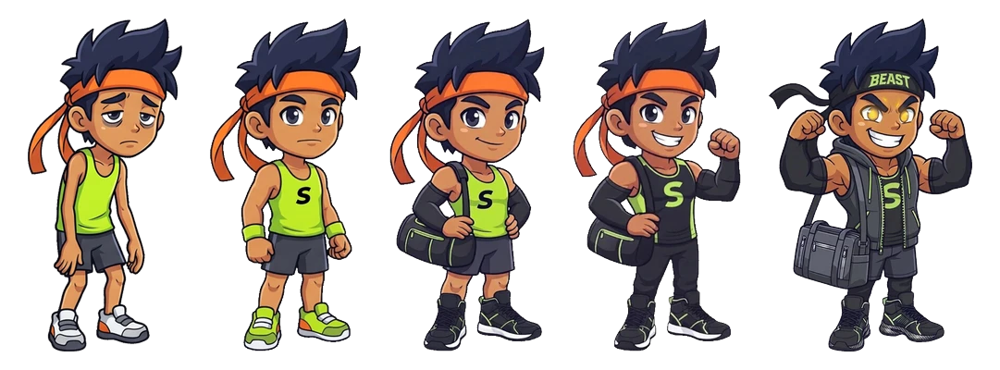
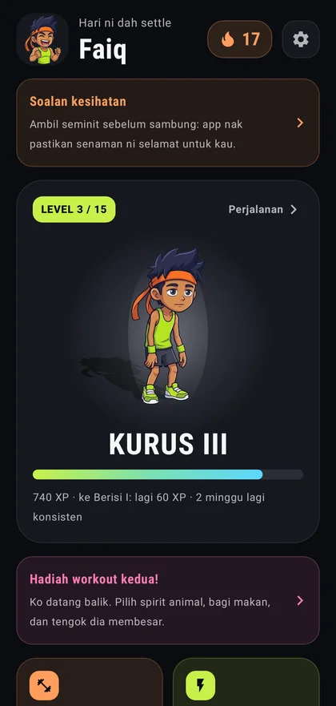
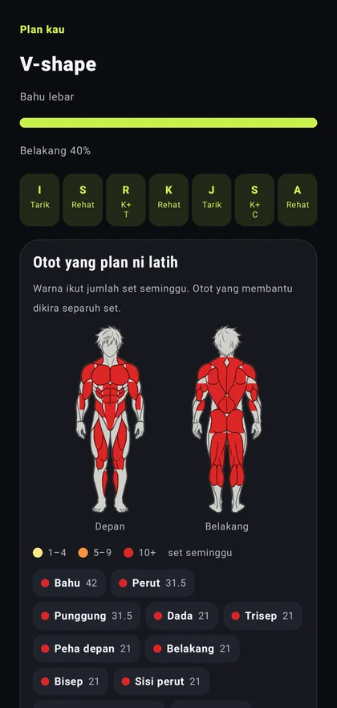
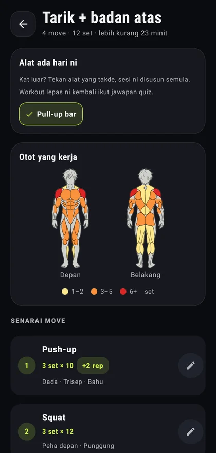
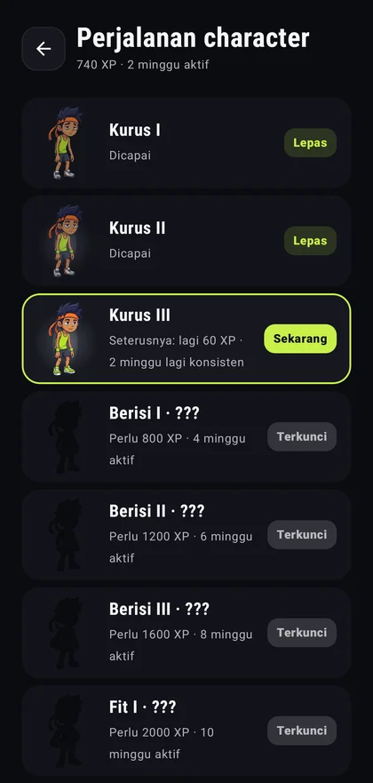
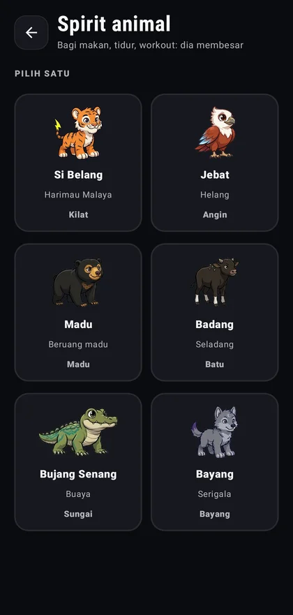
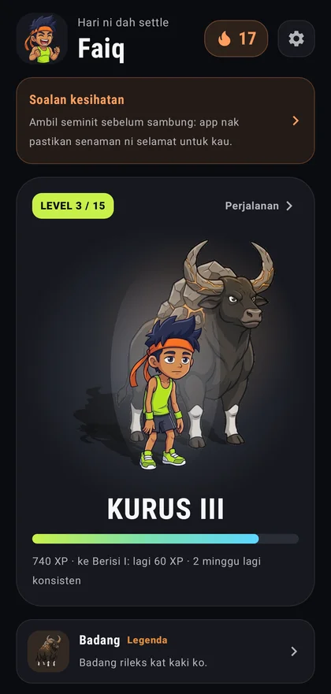
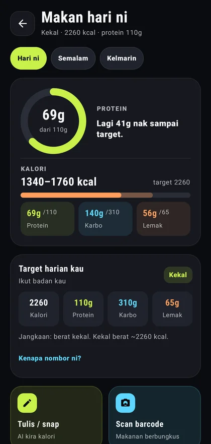
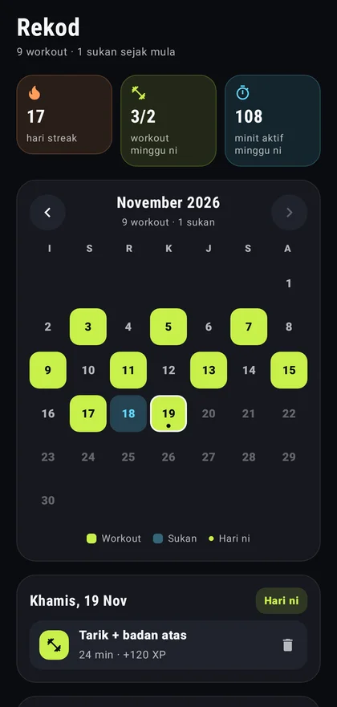

<div align="center">

# 💪 Sado

**App workout rumah dengan coach yang cakap rojak.**
Ikut plan, kumpul XP, tengok watak kau membesar dari *Kurus* sampai *Beast mode*, dengan spirit animal di sebelah.




</div>

---

## Kenapa Sado?

Kebanyakan app fitness rasa macam spreadsheet. Sado lain sikit:

- 🗣️ **Coach bercakap.** Suara coach cakap rojak Melayu-English, kira undur, bagi semangat masa separuh set, dan tegur bila kau rehat lama.
- 🎮 **Progress macam game.** 15 level, setiap satu perlukan XP *dan* minggu latihan sebenar, jadi watak tak boleh lebih laju dari badan kau.
- 🐯 **Spirit animal.** Dapat bila kau datang workout kali kedua. Bagi makan, tidur cukup dan workout, dan dia membesar dari Anak sampai Legenda.
- 🏠 **Untuk rumah.** Plan disusun ikut alat yang ada (pull-up bar, kerusi, dumbbell, band, backpack, botol air). Takde alat hari ni? Tekan je, sesi disusun semula.

## Skrin

<div align="center">




<br>




</div>

## Ciri-ciri

### 🏋️ Workout
- **Plan ikut bentuk badan:** V-shape, Aesthetic, Shredded, Besar & kuat, Atletik, Kurus & tone. Otot fokus diisi dulu sampai cukup set seminggu.
- **Progression berperingkat:** push-up, squat dan pull-up naik tangga (contohnya Knee push-up → Push-up → Archer push-up) bila kau rasa senang.
- **Warm-up:** bersedia 15 saat, kemudian Jumping jack 30 saat (atau March in place untuk low impact).
- **Set bertimer** berhenti sendiri bila cukup sasaran, jadi masa kau tarik nafas tak terkira.
- **Max rep** simpan rekod. Kena lepas rekod lama baru dikira naik.
- **Rest timer** dengan butang *Jom* yang bersinar bila rehat habis.

### 🧬 Watak dan level
- Dua laluan permulaan: **Kurus → Berisi → Fit** atau **Gempal → Bangkit → Fit**. Dipilih sekali masa mula dan tak bertukar di tengah jalan.
- Kemudian **Sado** dan **Beast mode**, yang perlukan ujian kekuatan.
- Streak mingguan, *Rehat jujur*, dan ujian 4 minggu (push-up, plank, pull-up max).

### 🐾 Spirit animal
Enam haiwan, masing-masing dengan elemen sendiri:

| | Haiwan | Nama | Elemen |
|---|---|---|---|
| 🐯 | Harimau Malaya | Si Belang | Kilat |
| 🦅 | Helang | Jebat | Angin |
| 🐻 | Beruang madu | Madu | Madu |
| 🐃 | Seladang | Badang | Batu |
| 🐊 | Buaya | Bujang Senang | Sungai |
| 🐺 | Serigala | Bayang | Bayang |

Setiap satu ada 4 peringkat: **Anak → Remaja → Dewasa → Legenda**. Yang Legenda berjalan di belakang watak kau sebagai penjaga.

### 🍛 Makan
- Log makanan dengan **tulis atau snap gambar**. AI anggar kalori dan protein, termasuk pecahkan hidangan set (nasi lemak, nasi campur).
- **Scan barcode** untuk makanan berbungkus.
- Sasaran kalori, protein, karbo dan lemak ikut badan dan matlamat kau.
- Semakan mingguan: berat, sesi dan protein 7 hari lepas.

### ⌚ Lain-lain
- **Health Connect:** langkah, degupan jantung (contohnya dari Garmin), tidur dan kalori.
- Tema gelap, cerah atau ikut phone.
- Backup dan restore fail `.sado`.

## Privasi

Semua data disimpan **dalam phone sahaja**. Takde akaun, takde analytics, takde iklan. Ciri AI (log makanan, suara clone) cuma hantar data bila kau guna sendiri, dengan API key kau sendiri.
Baca penuh: [PRIVACY.md](PRIVACY.md)

## Bina sendiri

Perlukan JDK 17 dan Android SDK 36.

```bash
./gradlew assembleDebug          # APK debug
./gradlew testDebugUnitTest      # unit test + screenshot test (Robolectric, Roborazzi)
```

Screenshot dari test disimpan dalam `app/build/screens/`.

## Tech

| | |
|---|---|
| UI | Kotlin, Jetpack Compose, Material 3 |
| Data | kotlinx.serialization, satu fail JSON dalam phone |
| AI makanan | Claude API (Anthropic Java SDK) |
| Suara | ElevenLabs, dengan TTS phone sebagai fallback |
| Kesihatan | Health Connect |
| Barcode | ML Kit |
| Test | JUnit, Robolectric, Roborazzi |

## Status

Projek peribadi, dibina untuk diri sendiri dan kawan-kawan. Sekarang dalam **internal testing** di Google Play.

<div align="center">
<sub>Dibuat di Malaysia 🇲🇾 · Jom gerak!</sub>
</div>
